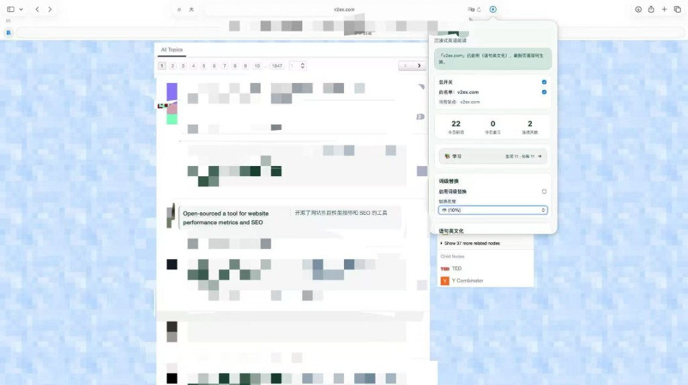
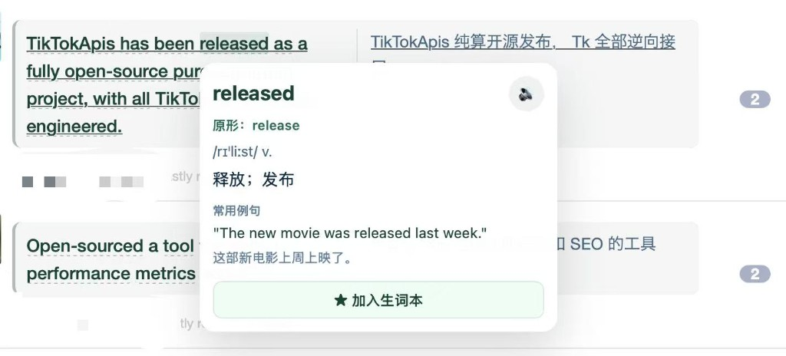
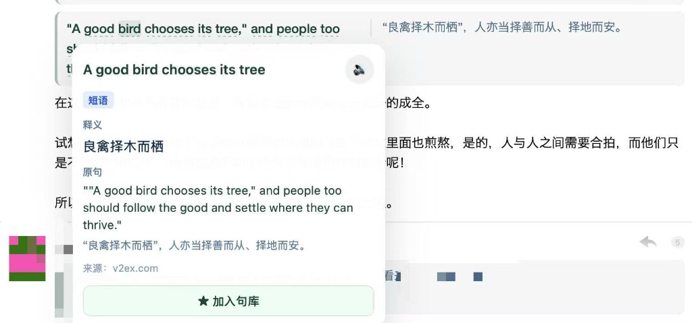
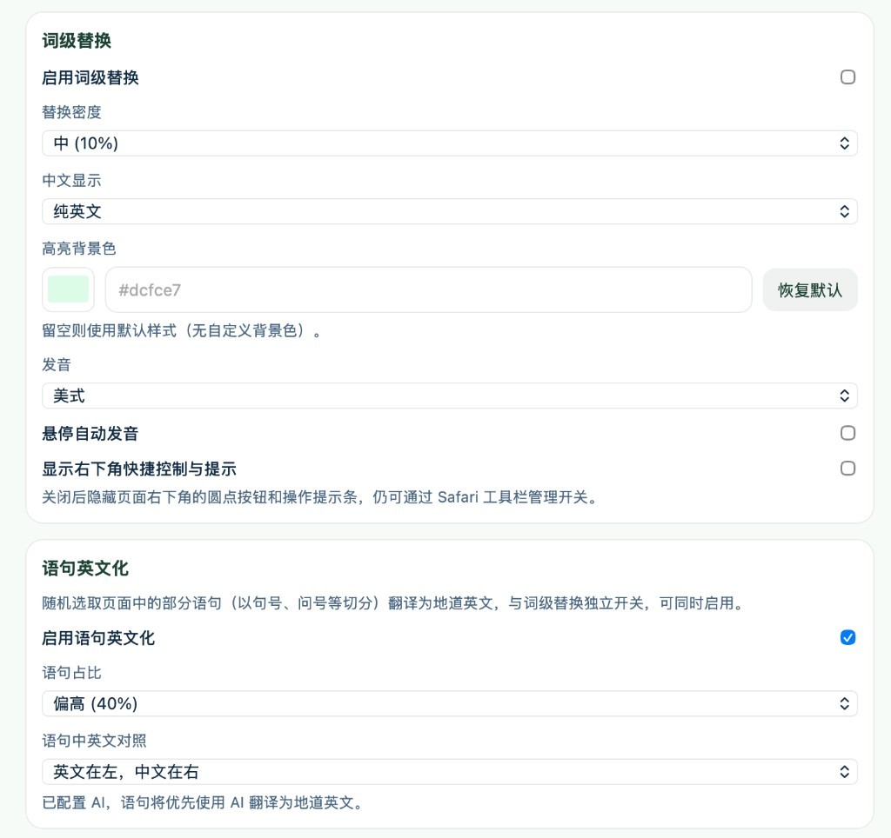
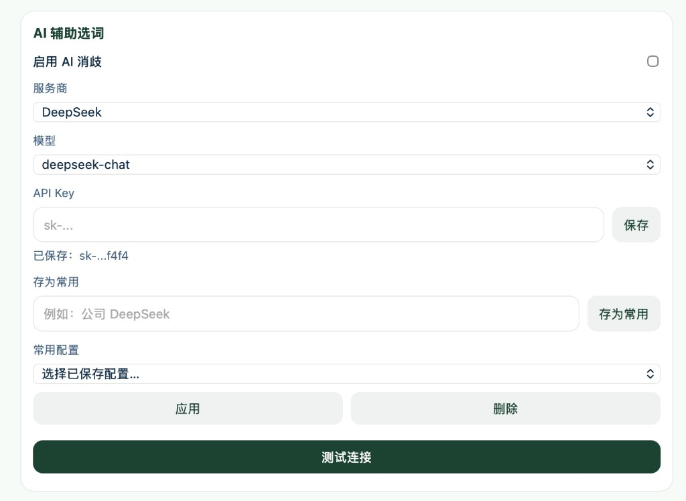
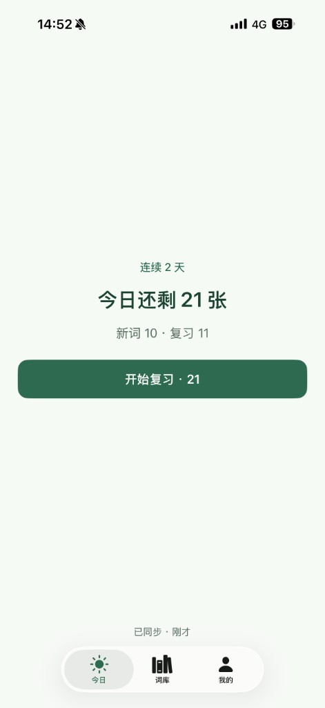
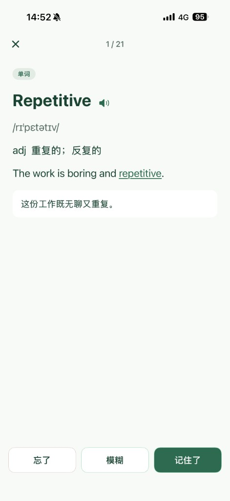
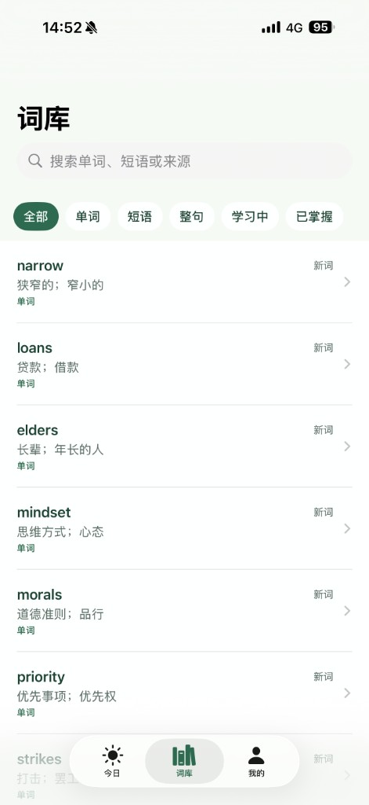
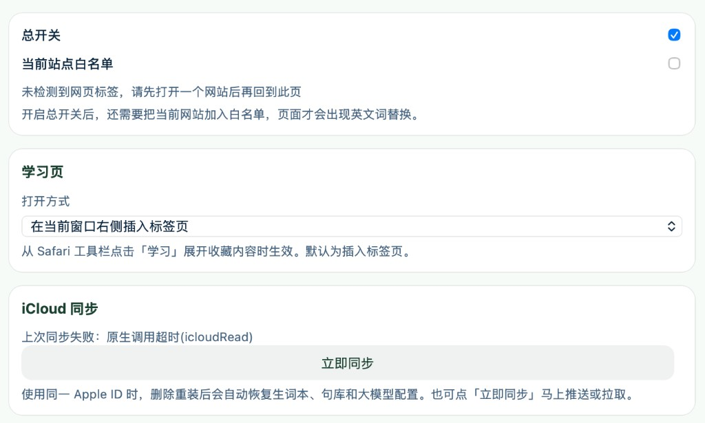

# GlossX

Safari 沉浸式英语阅读扩展。在中文网页里嵌入英文词和英文段落，把不熟的词收进生词本，并用 SM-2 间隔重复复习。提供 macOS 与 iOS 的 App，以及对应的 Safari Web Extension。

## 功能

### 在网页里读

工具栏弹窗可以打开总开关、把当前站点加入白名单，并查看今日新词、复习量和连续天数。白名单站点上，中文网页会按密度嵌入英文词，也可以把部分语句译成英文。

<p>
  
</p>

点开被替换的词，可以看到原形、音标、释义和例句，并加入生词本。划选短语或句子时，可以查看释义、原句和来源，并加入句库。

<p>
  
  
</p>

### 阅读方式

词级替换和语句英文化各自独立开关，可以同时打开。替换密度、中文是否保留、高亮色、发音，以及语句占比和中英对照方式都可以调整。替换用的词来自可多选的词库：日常高频、四级、六级、考研、雅思、托福。

<p>
  
</p>

<p>
  
</p>

语句翻译优先使用已配置的大模型，支持 OpenAI、DeepSeek、Anthropic、Moonshot，以及自定义的 OpenAI 兼容接口。API Key 由使用者自己填写并保存在本机。

<p>
  
</p>

### 收藏与复习

iOS 与 macOS 的学习页按 SM-2 安排今日队列，区分新词和到期复习。复习时展示音标、释义、例句和中文，并用「忘了 / 模糊 / 记住了」打分。词库可以按单词、短语、整句，以及学习中、已掌握来筛选。

<p>
  
  
  
</p>

### 站点与同步

总开关之外，还要把站点加入白名单，页面上才会出现替换。已登录 iCloud 时，生词本、句库、设置与大模型配置会同步到私有容器 `iCloud.com.xxg.Flipword`。

<p>
  
</p>

## 环境

- Xcode（含 iOS 与 macOS 平台）
- macOS 10.14 及以上，或 iOS 15 及以上
- 用于签名的 Apple 开发者团队

## 构建与运行

1. 用 Xcode 打开 `GlossX.xcodeproj`。
2. 选中 App 与 Extension 的各 Target，在 **Signing & Capabilities** 里把 **Team** 改成你自己的开发者团队。工程里目前写的是原作者的 Team ID `4CEAMHPC5F`，其他账号无法用它签名。
3. 运行 **GlossX (macOS)**（已共享的 Scheme），或为 **GlossX (iOS)** 这个 Target 运行。
4. 在 Safari 的「设置 → 扩展」里启用 GlossX。

iCloud 容器登记在原作者的团队下。换团队后若要使用同步，需要在 Apple Developer 里创建自己的 iCloud 容器，并改掉各 `*.entitlements` 中的 `iCloud.com.xxg.Flipword`。

macOS 安装包：

```bash
scripts/make-dmg.sh
```

脚本会以 Release 归档 **GlossX (macOS)**，并在 `dist/` 生成 DMG。签名身份同样要换成你自己的团队。

## 测试

核心复习与词库逻辑在 Swift Package `GlossXCore` 中：

```bash
cd GlossXCore
swift test
```

## 开发记录

- 2026-09-23 feat: 实现Mac扩展插件及iOS APP
- 2026-09-11 feat: 增加 APP 功能
- 2026-09-08 feat: 增加 iCloud 同步
- 2026-09-06 docs: 确认 iCloud 学习库整包同步规格
- 2026-08-28 feat: 增加图标；增加打包脚本
- 2026-08-17 feat: 修复划词翻译失败问题
- 2026-08-14 feat: 收藏内容打开支持以 tab 还是新窗口设置
- 2026-08-14 feat: 解决多内容网页后续内容未覆盖
- 2026-08-14 feat: 新增翻译超时及解决弹框偶尔无法消失
- 2026-08-14 feat: 优化词语收藏；增加导出
- 2026-08-12 feat: 支持按句翻译；使用 AI 翻译；支持加入收藏；支持存储模型记录及使用
- 2026-07-08 feat: 支持按句进行翻译
- 2026-06-29 feat: 支持单文字翻译替换
- 2026-06-28 Initial Commit

## 协议

本项目采用 [MIT License](LICENSE)。

简繁转换使用 [OpenCC](https://github.com/BYVoid/OpenCC) 的 JavaScript 构建，协议同为 MIT，见 `Shared (Extension)/Resources/lib/opencc-LICENSE.txt`。
