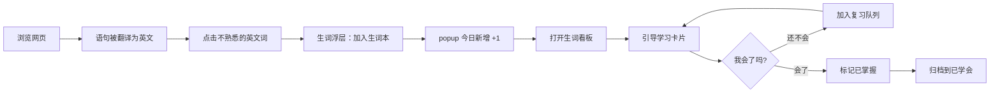

# 语句生词本 — 原型设计规格

**日期：** 2026-07-08  
**状态：** 已确认（方案 A）— 实现中 v1.3.0  
**依赖：** 语句英文化模式（`paragraph-translator.js`）、现有 `decode-panel` 交互范式

---

## 1. 背景与目标

### 1.1 用户场景

用户在浏览中文网页时，GlossX 将部分语句翻译为英文。阅读过程中，用户会遇到**不熟悉但想记住**的英文词。当前产品缺少：

1. 在语句上下文中**一键标记生词**的入口
2. 按天汇总、集中复习的**生词看板**
3. 围绕「发音 → 释义 → 例句」的**引导式学习**流程
4. 学会后标记为**已掌握**的闭环

### 1.2 产品目标

| 目标 | 衡量方式 |
|------|----------|
| 标记零摩擦 | 语句内点击单词 ≤ 2 步完成收藏 |
| 每日可回顾 | 看板默认展示「今日新增」，支持按日期浏览 |
| 引导学习 | 每张卡片完成「听 → 懂 → 用」三步 |
| 与阅读解耦 | 复习在独立页面完成，不打断浏览 |

### 1.3 与现有功能的关系

| 现有能力 | 本功能关系 |
|----------|------------|
| 词级替换 + decode-panel | **独立数据源**。词库词走 `wordRecords` + SM-2；语句生词走新的 `vocabItems` 集合 |
| 语句英文化 | **触发场景**。仅在已翻译的 `.glossx-sentence-en` 区域内可标记 |
| popup 统计「今日新词」 | **复用展示位**。数字 = 词库新词 + 语句生词之和（或分开展示，见 §6.2） |
| AI 服务 | 释义/例句优先 AI 生成；无 Key 时降级为词典缓存 + 原句上下文 |

> **设计原则：** 语句生词是「阅读中偶遇的真实词汇」，与 CET4 词库替换词的学习动机不同，因此使用独立集合，但复用发音（TTS）、SM-2 间隔复习、统计埋点等基础设施。

---

## 2. 用户旅程



---

## 3. 方案对比

### 方案 A（推荐）：语句内点词 + 独立生词看板页

- content 侧：翻译完成的英文词可点击，弹出精简版 `word-save-panel`
- 新页面 `vocabulary.html`：完整看板 + 学习卡片流
- popup 增加「生词本」入口按钮

**优点：** 阅读与复习分离；看板空间充足；与现有 decode-panel 模式一致。  
**缺点：** 新增一个扩展页面文件。

### 方案 B：全部塞进 popup / options

在 popup 底部折叠列表展示生词，学习也在 popup 内完成。

**优点：** 文件少。  
**缺点：** popup 空间极小，学习体验差，不适合卡片流。

### 方案 C：网页内浮层看板

在当前页面右下角打开侧边抽屉作为看板。

**优点：** 不离开当前页。  
**缺点：** 遮挡正文；与阅读场景冲突；样式受宿主页面影响。

**结论：采用方案 A。**

---

## 4. 交互原型

### 4.1 语句内标记生词

#### 触发条件

- 语句英文化已开启，且该句翻译完成（`data-glossx-sentence` 存在）
- 用户点击 `.glossx-sentence-en` 内的英文单词（按空格 / 标点分词）
- 已标记的词显示持久高亮（书签样式）

#### 线框图 — 语句区域

```
┌─────────────────────────────────────────────────────────┐
│  ...文章正文...                                          │
│                                                          │
│  ┌ glossx-sentence ─────────────────────────────────┐ │
│  │ The government announced new policies yesterday.    │ │
│  │      ────────                                       │ │
│  │      ↑ 已收藏：绿色下划线 + 角标 ★                   │ │
│  │  政府昨天宣布了新政策。                               │ │
│  └─────────────────────────────────────────────────────┘ │
│                                                          │
│  ...更多正文...                                          │
└─────────────────────────────────────────────────────────┘
```

#### 线框图 — 点词浮层 `word-save-panel`

复用 decode-panel 视觉语言，但更轻量：

```
        ┌──────────────────────────────┐
        │  announced          🔊       │
        │  /əˈnaʊnst/                  │
        │  v. 宣布；公布                │
        │  ──────────────────────────  │
        │  来自当前句：                 │
        │  "The government announced   │
        │   new policies yesterday."   │
        │  ──────────────────────────  │
        │  [ ★ 加入生词本 ]  [ 已收藏 ] │
        └──────────────────────────────┘
              ↑ 锚定在点击词下方
```

**交互细节：**

| 操作 | 行为 |
|------|------|
| 单击英文词 | 打开浮层；300ms 内重复点击同一词则关闭 |
| 点击 🔊 | Web Speech API 朗读（复用 `decode-panel.speak`） |
| 点击「加入生词本」 | 写入 `vocabItems`；词在句中高亮；浮层按钮变为「已收藏」；toast「已加入生词本」 |
| 点击「已收藏」 | 取消收藏，移除高亮 |
| 点击浮层外 | 关闭浮层 |
| Esc | 关闭浮层 |

**分词规则：**

- 按 `/[a-zA-Z'-]+/g` 切分
- 过滤长度 < 2 的词（如 `a`, `is`）—— 可在设置中提供「也收藏短词」开关（v2，默认关闭）
- 同一词在同一句中多次出现：点击任一处标记整句内所有相同词形

---

### 4.2 生词看板 `vocabulary.html`

从 popup「生词本」按钮或 options 导航进入全屏页面。

#### 页面结构

```
┌─────────────────────────────────────────────────────────────┐
│  ← 返回          我的生词本                    设置 ⚙       │
├─────────────────────────────────────────────────────────────┤
│  ┌─────────┐ ┌─────────┐ ┌─────────┐ ┌─────────┐           │
│  │ 今日 8  │ │ 学习中  │ │ 待复习  │ │ 已掌握  │           │
│  │  新增   │ │   24    │ │   6     │ │  156    │           │
│  └─────────┘ └─────────┘ └─────────┘ └─────────┘           │
├─────────────────────────────────────────────────────────────┤
│  [ 今日新增 ▾ ]  [ 全部 ]  [ 学习中 ]  [ 已掌握 ]           │
│  ─────────────────────────────────────────────────────────  │
│  7月8日 · 8 个新词                                          │
│  ┌──────────────────────────────────────────────────────┐  │
│  │ announced          宣布          来自 xxx.com    ★   │  │
│  │ policy             政策          来自 xxx.com    ★   │  │
│  │ ...                                                   │  │
│  └──────────────────────────────────────────────────────┘  │
│  7月7日 · 5 个新词                                          │
│  ┌──────────────────────────────────────────────────────┐  │
│  │ ...                                                   │  │
│  └──────────────────────────────────────────────────────┘  │
├─────────────────────────────────────────────────────────────┤
│            [ 开始今日学习 · 6 词待复习 ]                     │
└─────────────────────────────────────────────────────────────┘
```

**看板列表项：**

| 列 | 内容 |
|----|------|
| 主标题 | 英文词形 |
| 副标题 | 中文释义（首条） |
| 来源 | 收藏时的页面 hostname + 可选标题 |
| 状态图标 | ★ 新词 / ↻ 复习中 / ✓ 已掌握 |
| 点击行 | 进入该词的引导学习卡片 |

**筛选 Tab：**

| Tab | 筛选条件 |
|-----|----------|
| 今日新增 | `addedAt` 为今天 |
| 全部 | 所有未删除 |
| 学习中 | `status` ∈ `new`, `learning` |
| 已掌握 | `status` = `mastered` |

默认 landing：**今日新增**；若今日无新词，显示空状态插图 +「去阅读收藏你的第一个生词吧」。

---

### 4.3 引导学习卡片流

点击「开始今日学习」或列表中某个词，进入全屏卡片模式。

#### 三步引导（单卡内按步骤展开，非三个独立页面）

```
步骤 1/3  听
┌─────────────────────────────────────────┐
│                                         │
│              announced                  │
│            /əˈnaʊnst/                   │
│                                         │
│         ┌───────────────┐               │
│         │   🔊  听发音   │               │
│         └───────────────┘               │
│                                         │
│         [ 下一步：看释义 → ]              │
└─────────────────────────────────────────┘

步骤 2/3  懂
┌─────────────────────────────────────────┐
│              announced                  │
│                                         │
│   v. 宣布；公布；宣告                     │
│   n. 公告（罕见）                        │
│                                         │
│         [ ← 上一步 ]  [ 下一步：看例句 → ]│
└─────────────────────────────────────────┘

步骤 3/3  用
┌─────────────────────────────────────────┐
│              announced                  │
│                                         │
│   📖 你收藏时的原句                       │
│   The government announced new          │
│   policies yesterday.                   │
│   政府昨天宣布了新政策。                  │
│                                         │
│   💡 补充例句（AI 生成）                  │
│   She announced her resignation.        │
│   她宣布辞职。                           │
│                                         │
│   ┌──────────┐  ┌──────────┐          │
│   │ 还不会    │  │  会了 ✓  │          │
│   └──────────┘  └──────────┘          │
└─────────────────────────────────────────┘
```

**按钮语义：**

| 按钮 | 行为 | SM-2 |
|------|------|------|
| 还不会 | `status` → `learning`；进入间隔复习队列；下一张卡 | grade = `review` (quality 3) |
| 会了 ✓ | `status` → `mastered`；归档；下一张卡 | grade = `mastered` (quality 5) |

**卡片队列优先级：**

1. 今日新增且未学习过的词
2. SM-2 到期复习词
3. 其余学习中词按 `addedAt` 倒序

顶部进度条：`3 / 6`（当前队列进度）。

---

### 4.4 popup 入口变更

在现有统计区下方新增：

```
┌─────────────────────────────────┐
│  今日新词 8  │ 今日复习 3 │ 连续 5天 │
├─────────────────────────────────┤
│  📚  生词本               →     │  ← 新增，显示今日语句生词数 badge
├─────────────────────────────────┤
│  词级替换 ...                    │
└─────────────────────────────────┘
```

---

## 5. 数据模型

### 5.1 `vocabItems`（`browser.storage.local`）

```ts
type VocabItem = {
  id: string;              // hash(normalizedWord + sentenceHash) 或 uuid
  word: string;            // 词形，如 "announced"
  lemma?: string;          // 词元，如 "announce"（可选，AI 或规则提取）
  phonetic?: string;       // /əˈnaʊnst/
  pos?: string;            // v.
  definitions: string[];   // ["宣布", "公布"]
  exampleFromContext: {     // 收藏时的原句
    english: string;
    chinese: string;
    pageUrl: string;
    pageTitle?: string;
    hostname: string;
  };
  extraExample?: {          // AI 补充例句（学习时懒加载）
    english: string;
    chinese: string;
  };
  status: "new" | "learning" | "mastered";
  addedAt: number;         // 首次收藏时间戳
  learnedAt?: number;      // 标记已掌握时间
  // SM-2 字段（复用 wordRecords 结构）
  easeFactor: number;
  interval: number;
  repetitions: number;
  nextReviewAt: number;
};
```

存储键：`vocabItems: Record<string, VocabItem>`

### 5.2 释义获取策略

| 优先级 | 来源 | 时机 |
|--------|------|------|
| 1 | 本地词库匹配（`lexicon-*.json` 按词形 / 词元） | 收藏时同步 |
| 2 | AI 查词 API（background 新消息 `lookupWord`） | 收藏时异步补全 |
| 3 | 仅显示英文 + 「暂无释义，学习中补全」 | 兜底 |

补充例句：进入学习卡片步骤 3 时懒加载，缓存到 `extraExample`。

### 5.3 统计扩展

`stats` 新增字段：

```ts
{
  // 现有
  newWords: number;      // 词库新词（保持）
  reviews: number;
  streak: number;
  // 新增
  vocabNewToday: number; // 语句生词今日新增
  vocabReviewedToday: number;
}
```

popup「今日新词」展示：`newWords + vocabNewToday`（tooltip 可拆分来源）。

---

## 6. 架构与模块

```
content.js
  └─ initVocabMarking()
       ├─ 监听 .glossx-sentence-en click
       ├─ WordSavePanel.show(word, context)
       └─ sendMessage(saveVocabItem)

background.js
  ├─ saveVocabItem → Storage.upsertVocabItem
  ├─ lookupWord → AI / lexicon
  ├─ generateExtraExample → AI（懒加载）
  └─ gradeVocabItem → SM2.applyReview

lib/word-save-panel.js   （新，content 侧）
lib/vocabulary-storage.js（新，或扩展 storage.js）
vocabulary.html / vocabulary.js / vocabulary.css（新，看板 + 学习流）
```

### 6.1 `word-save-panel.js`

- 从 `decode-panel.js` 抽取共用的 `speak()`、定位逻辑
- 面板更窄，动作为「加入 / 取消生词本」
- 不显示 SM-2 三按钮（那是词库替换场景）

### 6.2 高亮持久化

已收藏词在 DOM 上添加：

```html
<span class="glossx-vocab-word" data-vocab-id="...">announced</span>
```

页面刷新后，content 在语句翻译完成时根据 `vocabItems` 重新包裹高亮（按词形匹配 `.glossx-sentence-en` 文本）。

---

## 7. 视觉规范

沿用现有绿色系（`#1b4332` / `#2d6a4f` / `#95d5b2`），新增：

| 元素 | 样式 |
|------|------|
| 已收藏词（语句内） | 绿色下划线 + 右侧小 ★（`::after`） |
| 点词 hover | 浅色背景 `rgba(45, 106, 79, 0.08)` |
| 看板统计卡 | 与 popup stats 一致的四格布局 |
| 学习步骤指示 | 顶部 `1 — 2 — 3` 圆点进度 |
| 「会了」主按钮 | 实心绿 `#2d6a4f` |
| 「还不会」次按钮 | 描边灰 |

暗色模式：跟随 `prefers-color-scheme: dark`，与 decode-panel 一致。

---

## 8. 边界与错误处理

| 场景 | 行为 |
|------|------|
| 语句翻译失败 / loading | 英文区域不可点词 |
| 重复收藏同一词（不同句子） | 合并为一条 `vocabItems`，`exampleFromContext` 保留最新，历史句存入 `contextHistory[]`（最多 3 条） |
| 取消收藏 | 删除记录，移除句内高亮 |
| 无 AI Key | 释义走词库；补充例句显示「配置 AI 可获得更多例句」 |
| 词库无匹配 + 无 AI | 浮层仅显示英文 + 原句，仍可收藏 |
| 存储上限 | 单用户最多 2000 条生词；超出时提示清理已掌握词 |
| 隐私 | options 说明：收藏会将单词及所在句子上下文存于本地；AI 查词时发送至所选服务商 |

---

## 9. 分期范围

### v1.0（本规格范围）

- [x] 语句内点词标记 / 取消
- [x] 生词看板（按日分组 + 筛选）
- [x] 三步引导学习卡片
- [x] 会了 / 还不会 → SM-2
- [x] popup 入口 + 统计

### v1.1（后续）

- 导出 Anki / CSV
- 按标签分组（手动）
- 复习推送提醒（Safari 通知，需额外权限）
- 语句内「长按选中短语」收藏

---

## 10. 测试计划

1. 翻译完成后点击词 → 浮层出现释义与原句
2. 加入生词本 → 词高亮持久、popup 计数 +1
3. 刷新页面 → 已收藏词仍高亮
4. 看板「今日新增」仅显示当天收藏
5. 学习流三步可前进/后退，「会了」进入已掌握 Tab
6. 「还不会」词在 N 天后出现在待复习队列（SM-2）
7. 无 AI Key 降级路径可用
8. 暗色模式样式正常
9. 与词级替换同时开启时不冲突（句子区域不触发词替换）

---

## 11. 已确认项

1. **popup「今日新词」**：✅ **方案 A** — 合并展示（词库 + 生词），hover title 拆分「词库 N · 生词 M」。
2. **短词过滤**：v1 默认忽略长度 < 2 的词，不提供开关。
3. **同一词多句**：v1 保留最新上下文，不实现 `contextHistory`。

---

## 12. 版本

实现完成后建议 manifest 版本升至 **1.3.0**。
