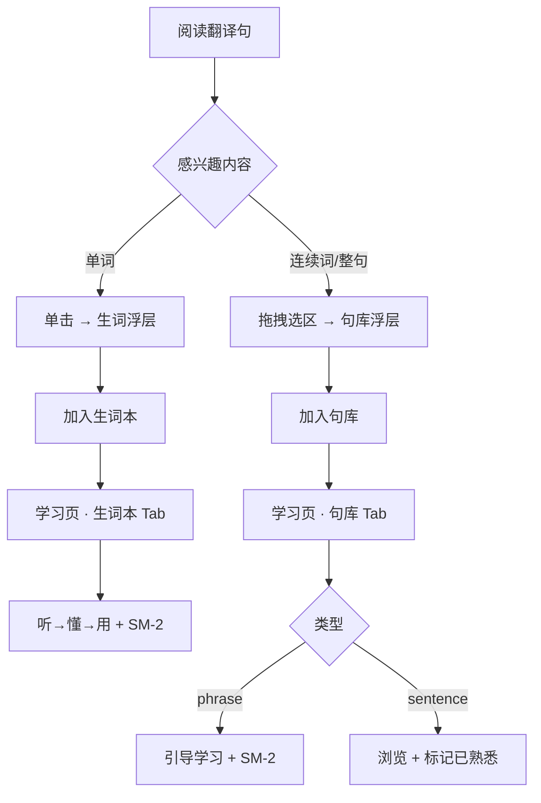

# 句子收集（句库）— 设计规格

**日期：** 2026-08-12  
**状态：** 已确认  
**依赖：** 语句生词本（`vocabItems`）、语句英文化（`.glossx-sentence-en`）

---

## 1. 背景与目标

用户在阅读翻译句时，除单个生词外，还可能对**短语搭配**或**整句表达**感兴趣。句库与生词本互补：

| | 生词本 | 句库 |
|--|--------|------|
| 单位 | 单词 | 短语 / 整句 |
| 触发 | 单击词 | 拖拽选区 |
| 目标 | 记词义 | 积累表达 / 语感 |
| 复习 | 全部 SM-2 三步 | 短语引导学习，整句轻量浏览 |

---

## 2. 已确认决策

1. **收藏范围（C）：** 短语 + 整句，按选区长度自动区分（≤6 词 → `phrase`，≥7 词或覆盖整句 → `sentence`）
2. **复习方式（C）：** 短语 → 听→懂→用 + SM-2；整句 → 列表浏览 + 标记「已熟悉」
3. **页面结构（C）：** popup 统一「学习」入口，`learning.html` 内 Tab：「生词本 | 句库」

---

## 3. 用户旅程



---

## 4. 交互设计

### 4.1 选区收藏

**触发：** `.glossx-sentence-en` 内拖拽选中英文，选区 ≥ 2 字符且含字母。

**冲突仲裁：** `mouseup` 时有非空选区 → 句库优先；无选区 → 现有点词逻辑。

**浮层内容：** 选中片段、片段中文（可选 AI）、完整中英文对照、来源 hostname、加入/取消按钮。

### 4.2 页面高亮（v1.5）

- 单词：现有 `.glossx-vocab-saved`
- 片段：`.glossx-snippet-saved`（淡蓝背景 + 左侧竖线）

---

## 5. 数据模型

### 5.1 `snippetItems`（`browser.storage.local`）

```ts
type SnippetItem = {
  id: string;
  text: string;
  type: "phrase" | "sentence";
  context: {
    fullEnglish: string;
    fullChinese: string;
    pageUrl: string;
    pageTitle?: string;
    hostname: string;
  };
  translation?: string;
  note?: string;
  status: "new" | "learning" | "familiar" | "mastered";
  addedAt: number;
  familiarAt?: number;
  easeFactor?: number;
  interval?: number;
  repetitions?: number;
  nextReviewAt?: number;
};
```

- 存储键：`snippetItems: Record<string, SnippetItem>`
- 上限：1000 条
- ID：`hash(normalize(text) + hostname)` 或 uuid

### 5.2 统计扩展

```ts
stats: {
  snippetNewToday: number;
  snippetReviewedToday: number;
}
```

popup「今日新词」：`newWords + vocabNewToday + snippetNewToday`  
tooltip：`词库 N · 生词 M · 句库 K`

---

## 6. 页面结构

### popup

- 「生词本」→「学习」，meta 显示「生词 M · 句库 K」
- 打开 `learning.html`

### learning.html

- Tab：生词本 | 句库
- 生词本 Tab：复用现有 `vocabulary.js` 逻辑
- 句库 Tab：`snippets.js` 列表 + 分流复习

### 向后兼容

- `vocabulary.html` 重定向到 `learning.html#vocab`

---

## 7. 句库 Tab UI

**筛选：** 今日 | 全部 | 短语 | 整句 | 已熟悉

**短语学习流（3 步）：** 听 → 懂（释义 + 对照）→ 用（语境确认）→ 还不会/会了

**整句浏览：** 展开全文、TTS、标记已熟悉，无 SM-2

---

## 8. 架构

```
lib/snippet-storage.js    CRUD + 类型判断 + stats
lib/snippet-utils.js      detectType, buildId, extractContext
lib/snippet-save-panel.js 选区浮层
lib/snippet-marker.js     选区监听 + 高亮（v1.5）
snippets.js               句库 Tab
learning.html / learning.js / learning.css
```

改造：`popup.*`、`content.js`、`content.css`、`manifest.json`、`background.js`、`storage.js`

---

## 9. 边界处理

| 场景 | 行为 |
|------|------|
| 选区跨中英文 | 仅取 `.glossx-sentence-en` 内文本 |
| 选区 < 2 字符 | 忽略 |
| 同页重复收藏 | 提示已存在 |
| 不同页相同片段 | 允许（id 含 hostname） |
| 存储满 1000 | 提示清理已熟悉整句 |
| 无 AI Key | 仍可收藏，显示原句对照 |

---

## 10. 分期

### v1.4 MVP

- snippet-storage + 选区浮层 + 句库列表
- learning.html 统一入口
- 整句浏览 + 短语收藏（列表，无学习流）

### v1.5

- 短语三步学习 + SM-2
- 页面片段高亮持久化

### v2.0

- 备注 / 标签 / 导出
- 补全生词本 `exampleFromContext`

---

## 11. 版本

实现完成后建议 manifest 版本升至 **1.5.0**（v1.4 MVP）/ **1.5.1**（短语学习流）。
